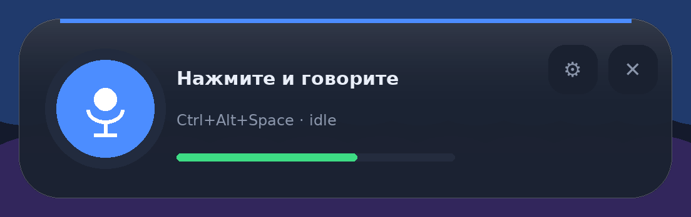

# 🎙 Голос

**Нажали кнопку — говорите. Текст сразу появляется там, где стоит курсор.**

Маленькая плашка в углу экрана, без окон и вкладок: клик по микрофону, говорите
обычным темпом — слова вставляются в активное поле по мере речи (кусками по
1–2 секунды), а не после того, как вы остановились. Русские и английские слова
можно мешать: «сделай commit и push в GitHub» так и запишется.

Распознавание идёт **на вашем компьютере** (faster-whisper), без интернета и без
отправки голоса в облако. Интернет нужен один раз — скачать модель.



---

## Что умеет

| | |
|---|---|
| 🎤 **Одна кнопка** | клик — запись, клик — стоп. Ничего настраивать не обязательно |
| ⚡ **Текст по ходу речи** | куски вставляются каждые 1–2 секунды, не дожидаясь конца |
| 📍 **Прямо у курсора** | клик по плашке не уводит каретку из вашего документа |
| 🌍 **Русский + английский** | мультиязычная модель определяет язык сама |
| 🪟 **Всегда сверху** | плашка 340×92 без рамки, перетаскивается мышью, не мешает |
| 🛑 **Ошибки видно сразу** | красный текст в плашке, значок «!» и журнал по клику |
| 🧠 **Whisper офлайн** | `small` по умолчанию — быстрый старт; можно выбрать точнее |
| ⌨️ **Горячая клавиша** | `Ctrl+Alt+Space` — то же самое, не трогая мышку |
| 🔔 **Трей** | иконка с индикатором записи, меню, автозапуск |

---

## Установка (Windows 10/11)

1. Установите [Python 3.10–3.12](https://www.python.org/downloads/windows/),
   отметив галочку **`Add python.exe to PATH`**.
2. Скачайте проект в любую папку, например `C:\Users\user\Downloads\golos`.
3. Запустите **`run.bat`** — он сам создаст окружение, поставит зависимости и
   запустит программу (первый раз несколько минут).

Обновление и запуск в дальнейшем:

```powershell
cd C:\Users\user\Downloads\golos
.\update.bat
```

`update.bat` сам остановит запущенную программу, переключится на `main`, сделает
`git pull` и запустит заново. Это важно: если рабочая копия осталась на старой
ветке, `git pull` пишет `Already up to date`, а код внутри — старый
(диагностика покажет «код отстаёт от main»).

Вручную то же самое:

```powershell
git checkout main
git pull
.\run.bat
```

| Файл | Что делает |
|---|---|
| **`run.bat`** | установка (если нужно) + запуск |
| **`update.bat`** | обновить код из `main` и перезапустить (если `git pull` «ничего не находит») |
| `run.bat --debug` | запуск с консолью: видно каждую ошибку |
| `install.bat` | только установка + ярлык на рабочем столе |
| `doctor.bat` | диагностика в терминале: запись, модель, распознавание, вставка |

Первый раз при диктовке скачается модель (`small` ≈ 480 МБ). Дальше интернет не
нужен.

---

## Как пользоваться

1. Запустите `run.bat` — внизу справа появляется плашка с микрофоном.
2. Поставьте курсор в любое поле: браузер, Word, Telegram, VS Code, поиск Windows.
3. Нажмите **кнопку микрофона** на плашке (или `Ctrl+Alt+Space`).
4. Говорите. Через 1–2 секунды текст начинает появляться у курсора, дальше —
   дописывается по мере речи.
5. Нажмите кнопку ещё раз — запись остановится, последний кусок допишется.

`Esc` во время записи — отменить и ничего не вставлять.

Плашка показывает состояние:

| Цвет | Значение |
|---|---|
| 🔵 синяя полоса, «Нажмите и говорите» | готов |
| 🔴 красная, кольцо пульсирует | слушаю, внизу уровень микрофона |
| 🟠 оранжевая, «Досказываю…» | дописываю последний кусок |
| 🔴 красный текст + «!» | ошибка, клик по «!» открывает журнал |

Правый клик по плашке — меню: **Настройки**, **Открыть журнал**, **Выход**.
Крестик скрывает плашку в трей, иконка в трее возвращает её обратно.

---

## Настройки

Правый клик → «Настройки…». Всё применяется сразу.

* **Модель** — `tiny` / `base` / `small` (по умолчанию) / `medium` / `large-v3`;
* **Язык** — Авто (рус + eng), Русский, English;
* **Вставка** — буфер + `Ctrl+V` (быстро) или посимвольно;
* **Микрофон** — список устройств ввода;
* **Горячая клавиша**, **звуки**, **автозапуск с Windows**.

Остальное — в `%APPDATA%\Golos\config.json`, в том числе:

| Параметр | По умолчанию | Смысл |
|---|---|---|
| `streaming` | `true` | вставлять текст по ходу речи |
| `stream_step` | `0.35` | как часто проверять новый звук, сек |
| `min_chunk_seconds` | `0.8` | минимум звука для очередного куска |
| `hold_back_seconds` | `0.3` | сколько придерживать, чтобы не разрезать слово |
| `force_commit_seconds` | `2.5` | если паузы нет — вставить всё, кроме последнего слова |
| `model` | `small` | модель Whisper |
| `beam_size` | `3` | качество/скорость распознавания |

Хотите «всё и сразу после остановки», как раньше? Поставьте `"streaming": false`.

Таблица моделей:

| Модель | Загрузка | Когда выбирать |
|---|---|---|
| `tiny` | ~75 МБ | очень старый ноутбук, короткие команды |
| `base` | ~145 МБ | быстро, но ошибок больше |
| **`small`** | ~480 МБ | **по умолчанию**: быстрый старт и нормальная точность |
| `medium` | ~1.5 ГБ | точнее, но первая загрузка 10–20 с |
| `large-v3` | ~3 ГБ | максимум точности, желательно видеокарта NVIDIA |

---

## Диагностика в терминале

Одна команда показывает по шагам, что работает, а что нет:

```powershell
cd C:\Users\user\Downloads\golos
.\doctor.bat
```

Скрипт проверяет: Python и файлы проекта, настройки, пакеты, микрофоны,
горячую клавишу, буфер обмена, **запись с микрофона (попросит поговорить
несколько секунд)**, загрузку модели, распознавание, поведение потоковой
вставки и последние строки журнала. По каждому пункту печатает `[ OK ]`,
`[ ?? ]` или `[БЕДА]`, в конце — список проблем. Отчёт дублируется в
`diagnostic.txt`.

Полезные варианты:

```powershell
.\doctor.bat --fix        # привести config.json к рабочим значениям (с бэкапом)
.\doctor.bat --record 8   # писать микрофон 8 секунд вместо 5
.\doctor.ps1 -Fix         # то же самое из PowerShell
.venv\Scripts\python.exe -m golos.diagnose --no-record   # без записи
```

Что означают частые сообщения:

| Сообщение | Что делать |
|---|---|
| `[БЕДА] нет пакета …` | `run.bat` не доустановил зависимости — запустите `install.bat` |
| `[БЕДА] микрофон молчит (тишина)` | Параметры → Конфиденциальность → Микрофон → разрешить приложениям |
| `[БЕДА] модель вернула пустой текст` | проверьте микрофон и язык (`Авто` для русского + английского) |
| `[БЕДА] не удалось назначить ctrl+alt+space` | сочетание занято — смените в настройках плашки |
| `[ ?? ] слов до порога нет` | нормально: сработает принудительная вставка через 2.5 с |
| `[ ?? ] видеокарта есть, но не хватает cublas64_12.dll` | работаем на CPU; `--fix` переключит на `"device": "cpu"` |
| `[ ?? ] код отстаёт от main` | запустите `update.bat` — иначе исправления не подхватятся |
| `[ ?? ] модель small ещё не скачана` | первый запуск скачает ~470 МБ: это минуты, нужен интернет |
| `… модель small: идёт 40 c` | так диагностика показывает, что не зависла, а грузит модель |
| `[ ?? ] запущено без прав администратора` | в админские окна (часто браузер) текст не вставится — см. ниже |

## Если текст не появляется

1. Плашка показывает состояние: серая строка `слушаю…` и «вставлено: …» после
   каждой вставки. Если `вставлено:` не появляется — смотрите пункт про
   потоковую вставку в `doctor.bat`.
2. **Окно-получатель от администратора — главная причина «текст есть, а в поле пусто».**
   Windows не пропускает нажатия клавиш из программы с обычными правами в окно,
   запущенное от имени администратора. Чаще всего так запущен браузер — тогда
   распознавание работает, плашка пишет «вставлено», а в поле ничего нет.

   Начиная с версии 1.2 «Голос» сам просит права при запуске: при первом
   `run.bat` Windows покажет запрос UAC — нажмите **«Да»**. Если отказались
   (или включён автозапуск, где UAC не спрашивается), воспользуйтесь меню:
   правый клик по иконке микрофона в трее → **«Перезапустить от администратора»**.

   Настройки этого поведения:

   | Что | Как |
   |---|---|
   | Не спрашивать права никогда | `"run_as_admin": false` в `config.json` или `run.bat`/`golos_app.py --no-admin` |
   | Галочка в интерфейсе | правый клик по плашке → «Настройки» → «Права администратора» |
   | Уже запущено, права нужны сейчас | трей → «Перезапустить от администратора» |
   | Просто убрать лишние права у браузера | ярлык → Свойства → Дополнительно → снять «Запуск от имени администратора» |

   Если права есть, но вставки всё равно нет, в журнале будет строка
   `Вставка в окно: «…» (chrome.exe)`, а при блокировке — не «вставлено»,
   а понятная ошибка на плашке.
3. **Способ вставки.** Правый клик по плашке → «Настройки» → «Вставка» →
   «Посимвольно» — помогает там, где буфер обмена не срабатывает.
4. **Быстрый обходной путь без потокового режима.** В `%APPDATA%\Golos\config.json`
   поставьте `"streaming": false` — текст вставится после остановки записи
   (этот путь самый стабильный).

## Файлы и приватность

```
%APPDATA%\Golos\config.json   настройки
%APPDATA%\Golos\golos.log     журнал (ротация 1 МБ × 3)
%APPDATA%\Golos\history.txt   история диктовок (можно отключить)
%APPDATA%\Golos\models\       модели Whisper
```

Аудио не пишется на диск и никуда не отправляется: всё обрабатывается в памяти.
Единственный сетевой запрос — скачивание модели при первом использовании.

---

## Что нового в 1.2

* **Текст вставляется в любые окна.** Windows (UIPI) выбрасывает нажатия из
  программы без прав, если окно-получатель запущено от администратора — обычно
  это браузер. Теперь «Голос» при запуске сам просит права (запрос UAC, «Да»),
  в трее есть пункт «Перезапустить от администратора», а в настройках — галочка.
* **Больше нет ложного «вставлено».** Перед вставкой проверяются права
  окна-получателя; если ввод заблокирован, плашка показывает понятную ошибку
  с решением, а в журнал пишется строка `Вставка в окно: «…» (chrome.exe)`.
* `Ctrl+V` отправляется пошагово (модификатор, пауза, клавиша) — браузеры и
  Electron-приложения принимают такое нажатие надёжнее.
* Диагностика проверяет права администратора и объясняет, что с ними не так.
* `run.bat` ждёт завершения запроса UAC и не пугает ложной ошибкой запуска.

## Что нового в 1.1

* Исправлена главная причина «микрофон работает, а текста нет»: при
  непрерывной речи Whisper возвращает один сегмент до самого конца записи, и
  прежнее условие вставки не выполнялось никогда. Теперь вставка идёт по
  словам, а если паузы нет — через `force_commit_seconds` (по умолчанию 2.5 с),
  причём последнее слово придерживается.
* Диагностика в терминале (`doctor.bat`) вместо скрипта в чате: UTF-8,
  проверка записи, уровня, модели, распознавания и самой потоковой логики.
* Плашка показывает `вставлено: …` после каждой вставки — видно, что текст ушёл.
* Настройки прошлых версий автоматически переписываются на рабочие.

---

## Разработка

```bash
python -m venv .venv
.venv\Scripts\activate
pip install -r requirements-dev.txt
python -m pytest -q          # 171 тест, ~4 секунды
python golos_app.py --debug  # запуск с журналом в консоли
```

Аргументы: `--debug`, `--no-gui` (текст в консоль), `--silent` (только трей),
`--status` (запущен ли, код 0/1), `--config PATH`, `--version`.

```
golos/
  overlay.py      плашка 340×92: кнопка, уровень, ошибки, мини-настройки
  streaming.py    потоковое распознавание + вставка по кускам
  winfocus.py     WS_EX_NOACTIVATE и возврат фокуса (ctypes, без зависимостей)
  app.py          ядро: запись → распознавание → вставка, состояния, статистика
  audio.py        микрофон (sounddevice), снапшоты для потока, обрезка тишины
  transcribe.py   faster-whisper: ленивая загрузка, сегменты с таймингами
  textproc.py     чистка текста: пунктуация, склейка алфавитов, замены
  inject.py       вставка: буфер + Ctrl+V или посимвольно
  hotkeys.py      глобальные клавиши, pretty_hotkey
  tray.py         иконка в трее с индикатором записи
  config.py       настройки и миграция старых конфигов
  system.py       один экземпляр, автозапуск, диалоги ошибок
golos_app.py      точка входа: оверлей + трей + очередь событий
  diagnose.py     диагностика в терминале (doctor.bat)
tests/            171 тест без Windows, микрофона и модели
```

Ядро (`DictationApp`) не зависит от GUI: интерфейс получает события через
`UiBridge`. В тестах подменены звуковая карта, движок Whisper, буфер обмена,
клавиатура и tkinter, поэтому вся логика проверяется на Linux/CI.

---

## Ограничения

* Только Windows (перехват клавиш, автозапуск, `WS_EX_NOACTIVATE`).
* Потоковый режим — скользящее окно, а не «настоящий» стриминг Whisper: на
  границах кусков возможны шероховатости в пунктуации. Длинные паузы режут текст
  на фрагменты (каждый вставляется отдельно).
* По одному куску за раз: если говорить очень быстро и долго, распознавание может
  немного отставать.
